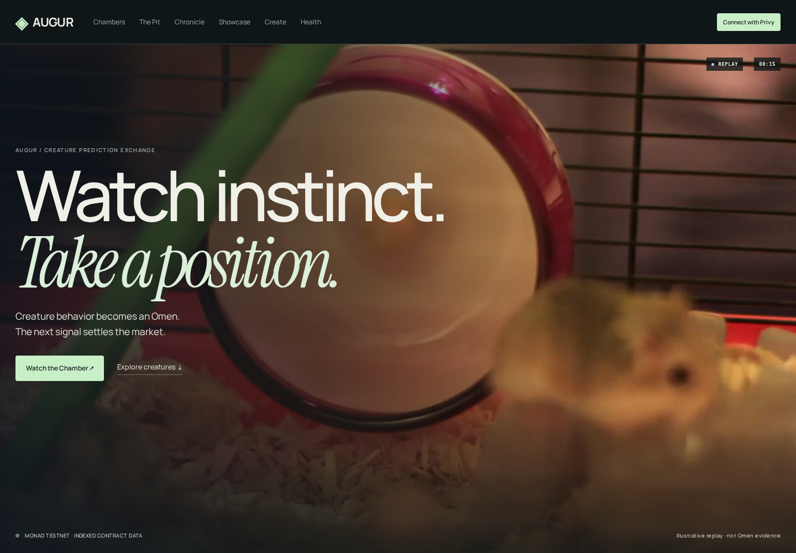
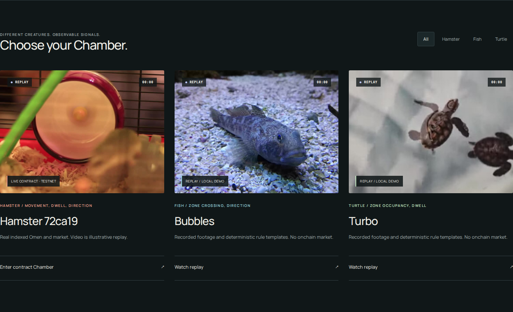
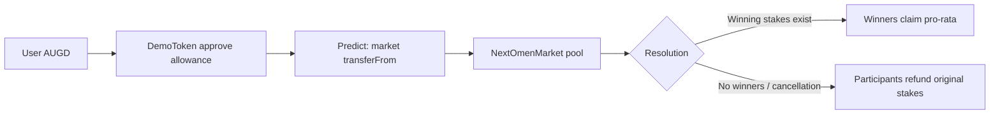
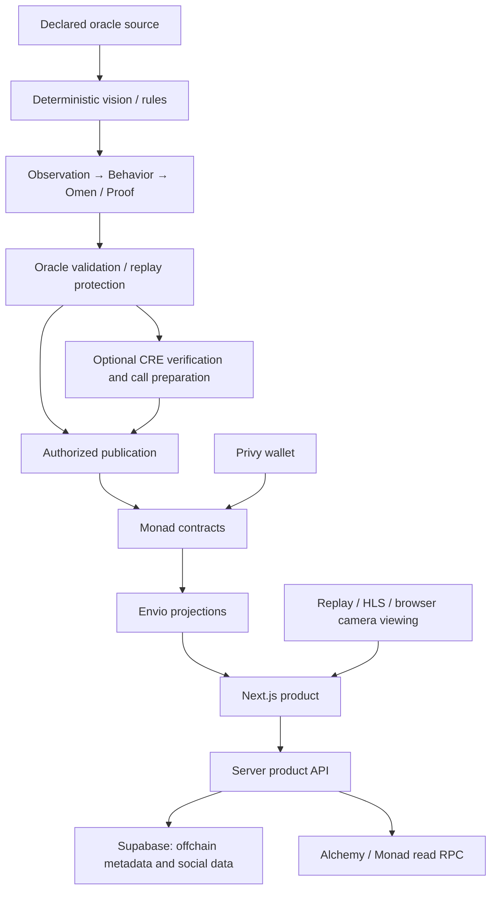

# Augur

**Watch instinct. Take a position.**

Augur is a creature prediction exchange: declared observations pass through deterministic behavior rules to produce BUY, HOLD, or SELL **Omens**. Participants stake AUGD on the next qualifying signal; authorized publication resolves the market on Monad. Every Omen binds a creature, sequence, ruleset, and provenance commitment. The animal never trades or holds funds.



[Monad deployment](deployments/monad-testnet-10143-67521320.json) · [CRE verification](cre/README.md) · [Indexer setup](indexer/README.md) · [Product audit](docs/SUBMISSION-AUDIT.md)

## The viewing rooms

Hamster has a real indexed Monad Testnet Chamber. Fish and Turtle have recorded viewing rooms and local deterministic demonstrations—not fabricated onchain markets. Contract data and media mode are separate: **LIVE CONTRACT** means deployed contract records, never a claim that an illustrative video is live.



- **Recorded replay:** licensed, bundled creature footage, with source credits. It is illustrative and does not attest to the indexed Omen.
- **Live source:** a configured public HLS stream or an explicitly enabled browser camera. No live stream is supplied by this repository. Camera video is not recorded or uploaded by the player.
- **Simulation:** deterministic observations and local market cycles, labeled separately. Video playback does not automatically perform computer vision, generate an Omen, or publish a transaction.

[Media credits and licenses](web/public/media/CREDITS.md) · [Fish replay](docs/images/fish.png) · [Turtle replay](docs/images/turtle.png)

## Inside a Chamber

The viewing stage dominates the page. Published behavior, Omen, market state, pool, and wallet position remain distinct from unavailable source evidence. Approval, prediction, and settlement each have their own status and transaction hash. An indexed update failure retains a disclosed last-known indexed view; it never replaces it with fixtures.


Motion follows the product: scroll-linked viewing expansion, route entry/exit, editorial reveals, Omen/state transitions, pool bars, transaction feedback, battle introductions, and reaction bursts. Reduced-motion preferences disable spatial animation and automatic replay playback.

## How the money moves



Participants stake on SELL, HOLD, or BUY. All three sides contribute to one pool. Losing stakes fund the winning payout pool; they do **not** go to an Augur treasury.

Illustrative example: SELL **3 AUGD**, HOLD **2 AUGD**, BUY **5 AUGD** → **10 AUGD** total. If BUY wins, the 5 AUGD of BUY positions share all 10 AUGD. A 1 AUGD winning stake receives 2 AUGD. Integer division applies, and the final winning claimant receives the remaining rounding balance.

**Platform fee: none. Platform treasury: none.** No winning stakes means cancellation. Cancelled markets refund each participant's original stake. Approval only grants permission; it does not place a prediction or move tokens into the pool. AUGD is a demo/testnet asset, not a claim about real-money liquidity.

## Repeated rounds and historical records


The Showcase has an explicit local simulation boundary, even when the main app uses Envio. Its operations and durations are not Monad TPS measurements. It sends no blockchain transactions, and its process-local rounds can reset on a serverless cold start.


Chronicle reports the configured data source, not invented rankings. Payout eligibility is explained from market state; this view does not claim a complete participant claim ledger. Battles currently present declared local Omen/price replays with virtual PnL, not funded onchain matchups.

[Battles](docs/images/battles.png) · [Partial proof](docs/images/proof.png) · [Create / operator preparation](docs/images/create.png) · [Mobile Chamber](docs/images/chamber-mobile.png)

## Verified integrations

| Integration | Role | Verified scope |
| --- | --- | --- |
| Monad Testnet, **10143** | Publication and market settlement | Six deployed contracts; registration → publication → prediction → BUY resolution → claim smoke lifecycle |
| Envio | Event-derived product views | Local HyperIndex indexed real Monad events; GraphQL-to-web data path verified. No hosted endpoint is fabricated. |
| Alchemy | Server-side Monad RPC | Chain, block, deployed bytecode, reads, receipts and logs verified; generic Monad RPC is the only fallback. |
| Privy | Authentication and wallet signing | Previous manual login/reconnect and a real 1 AUGD DemoToken approval verified. Final production-origin authentication remains manual. |
| Chainlink CRE | Provenance-bound request orchestration | Official v1.36.0 build and authenticated simulation, deterministic Monad calldata and rejection cases verified. Organization deployment access remains blocked. |

CRE validates the deterministic oracle's publication request; it does not invent behavior or attest camera honesty. It is an optional verified simulation path, not a deployed production workflow. No deployed workflow ID is claimed.

### Public testnet evidence

- OmenPublisher: `0x333c7ba28b6Eec62f51d111d161fc52fd3ADAa1a`
- NextOmenMarket: `0x334761518FAD86f9cddDbE16a42CFb9316fD4D9E`
- DemoToken: `0xFF35f01886B83D1782e1170c33D3A11E75b0e90e`
- Verified Privy-signed `DemoToken.approve(NextOmenMarket, 1e18)`: `0x0bf842f8992228d54da917523ce075aa930bad76888148ec09b637ff17d5584a`, block **67812342**. Calldata, successful receipt, Approval event, and allowance were independently checked in the earlier integration pass.

The indexed smoke record includes CreatureRegistered, ChamberConfigured/activation, OmenPublished sequence 1, MarketOpened, PredictionPlaced, MarketLocked, MarketResolved BUY, and Claimed. See [deployment metadata](deployments/monad-testnet-10143-67521320.json) for transaction hashes and deployment blocks. This product pass sent no new contract transaction.

## Architecture



Viewing and oracle capture are separate boundaries. Protocol truth remains in Monad contracts; Envio serves projections. Supabase stores creature/Chamber metadata, media descriptors, replay records, chat, and reactions. It does not duplicate balances, stakes, Omens, or settlement. SQLite remains the local adapter. No private camera footage is stored.

The [migration and production adapter](supabase/README.md) are implemented and tested against disposable local Postgres, with server-only access, RLS and atomic social rate limits. **Hosted Supabase connectivity is not verified without credentials.** Vercel refuses a SQLite production fallback; database failures are explicit.

## Run locally

Node.js **24**, pnpm **11.2.2**, Python 3.11+, and Docker for the local indexer. Foundry is needed for Solidity tests; CRE requires Bun and the official CRE CLI.

```bash
make install
cd web
pnpm install --frozen-lockfile

# Explicit local wallet/data simulation; use only with ENVIO_GRAPHQL_URL unset.
NEXT_PUBLIC_PRIVY_LOCAL_MODE=true pnpm dev
```

For the real-data demo, configure ignored root `.env` or `web/.env.local` using the examples. Do not overwrite an existing environment. Start the existing local Envio services, then:

```bash
cd web
pnpm demo:build
PORT=3010 pnpm demo:start
```

Open `http://localhost:3010/chambers/indexed-9d6541b7a855bf7c`. The demo commands load the ignored root environment, select the configured indexer or public non-secret localhost default, and require the real chain/Chamber preflight. An unavailable indexer stops startup, rather than choosing fixtures. Ordinary Next.js commands retain standard environment loading.

### Configuration

| Variable | Boundary |
| --- | --- |
| `NEXT_PUBLIC_PRIVY_APP_ID` | Public Privy identifier |
| `NEXT_PUBLIC_MONAD_CHAIN_ID` | `10143` |
| `NEXT_PUBLIC_MONAD_RPC_URL` | Deliberately public browser RPC, never a server-secret endpoint |
| `NEXT_PUBLIC_*_ADDRESS` | Verified contract addresses in `.env.example` |
| `ALCHEMY_MONAD_RPC_URL` | Preferred server-only RPC |
| `MONAD_RPC_URL` | Generic server RPC fallback |
| `ENVIO_GRAPHQL_URL` | Server indexed reads; public HTTPS service required on Vercel |
| `SUPABASE_URL` | Server database project endpoint |
| `SUPABASE_SECRET_KEY` | Server-only database key; legacy `SUPABASE_SERVICE_ROLE_KEY` also supported |
| `CHAINLINK_CRE_WORKFLOW_ID` | Set only after a real deployment exists; currently unset |

Never commit `.env`, credentials, signing keys, or auth files. Do not place server RPC/database keys in `NEXT_PUBLIC_*`.

## Production deployment

The Vercel project **augur** is linked, Node 24 and frozen-lockfile settings are prepared, and the existing public contract/Privy configuration plus server RPC values were configured without printing them. The production attempt stopped at its configuration guard: missing **public HTTPS `ENVIO_GRAPHQL_URL`**, **`SUPABASE_URL`**, and **`SUPABASE_SECRET_KEY` / `SUPABASE_SERVICE_ROLE_KEY`**. There is **no working production URL yet**.

Apply the Supabase migration, configure those services in Vercel's production environment, and run:

```bash
cd web
pnpm production:check
vercel deploy --prod
```

`production:check` requires real integration configuration and rejects localhost indexing. It checks configuration presence, not service connectivity; deployment must then be verified against `/health`, indexed Chamber, Proof and Chronicle. See [production checklist](docs/PRODUCTION.md).

Add the exact successful deployment origin to Privy's allowed origins if required, then interactively verify login, wallet availability, Monad 10143 and reconnect. Opening the login form is not authenticated verification. No final-origin session or production transaction is claimed here.

## Validation and presentation captures

```bash
cd web
pnpm test
pnpm typecheck
pnpm lint
pnpm demo:build
node scripts/secret-check.mjs
cd ..
make test-python
git diff --check
```

The browser audit covers 1440px, 1024px, 390px and 430px, real-data routes, replay loading, reduced motion and local Showcase rounds. All README images are captures of the running app; no authenticated session is staged. The indexed screenshots use real Envio records; the Showcase GIF uses explicitly labeled local simulation.

To recapture, install Playwright in a temporary tooling directory and Chromium, then point `PLAYWRIGHT_MODULE_PATH` to its `index.mjs`:

```bash
cd web
PLAYWRIGHT_MODULE_PATH=/absolute/tooling/path/playwright/index.mjs node scripts/browser-audit.mjs
python3 scripts/gif-from-frames.py ../.presentation-frames ../docs/images/showcase.gif
```

Pillow is required only for GIF export. Raw capture frames stay ignored.

## Honest limits

- Testnet, not mainnet. AUGD is a demo asset. No fee or treasury.
- Hamster contract data is real; Fish/Turtle viewing rooms are replays/local demonstrations.
- Bundled video is illustrative, not the smoke Omen's evidence. Full indexed offchain manifests are unavailable; real publication commitments remain visible.
- Browser camera/HLS viewing does not itself feed the oracle, attest source honesty, or publish Omens.
- Permissionless registration is disabled in the deployed policy. Creation prepares offchain configuration for authorized operator review.
- Battle scores and Showcase rounds are declared local simulations, not live onchain volume or yield.
- Supabase adapter/migration are prepared and locally tested; hosted connectivity awaits credentials. Public Envio hosting and working Vercel production await configuration.
- CRE is authenticated-simulation verified, not deployed. Final Privy origin authentication is an interactive check.
