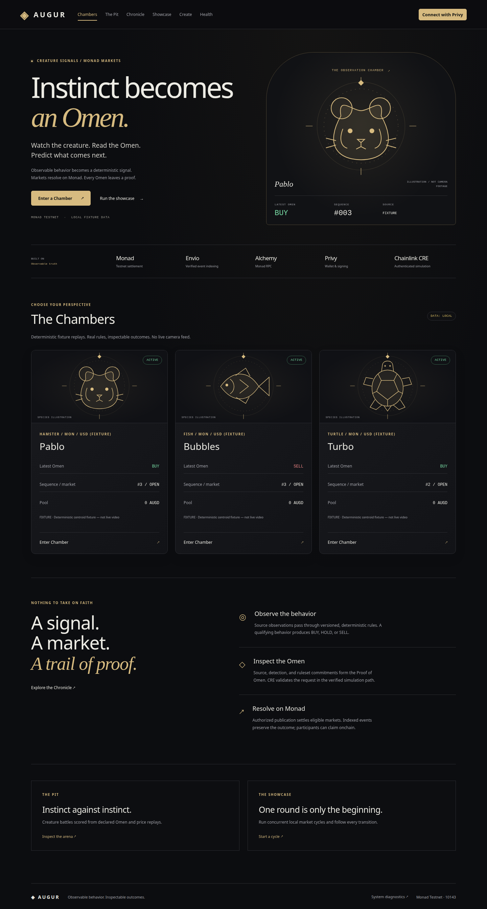
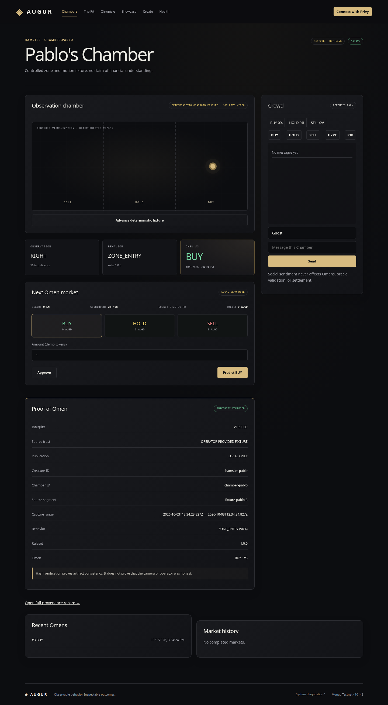
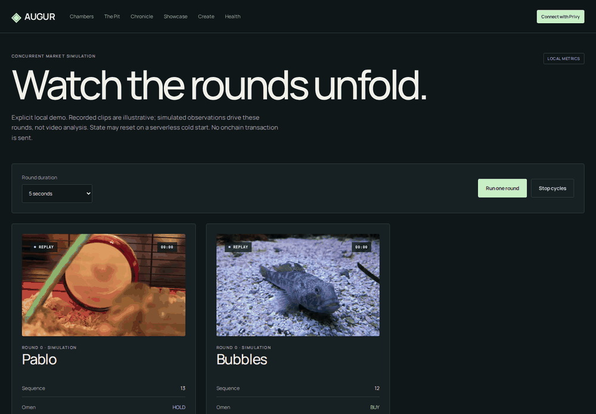
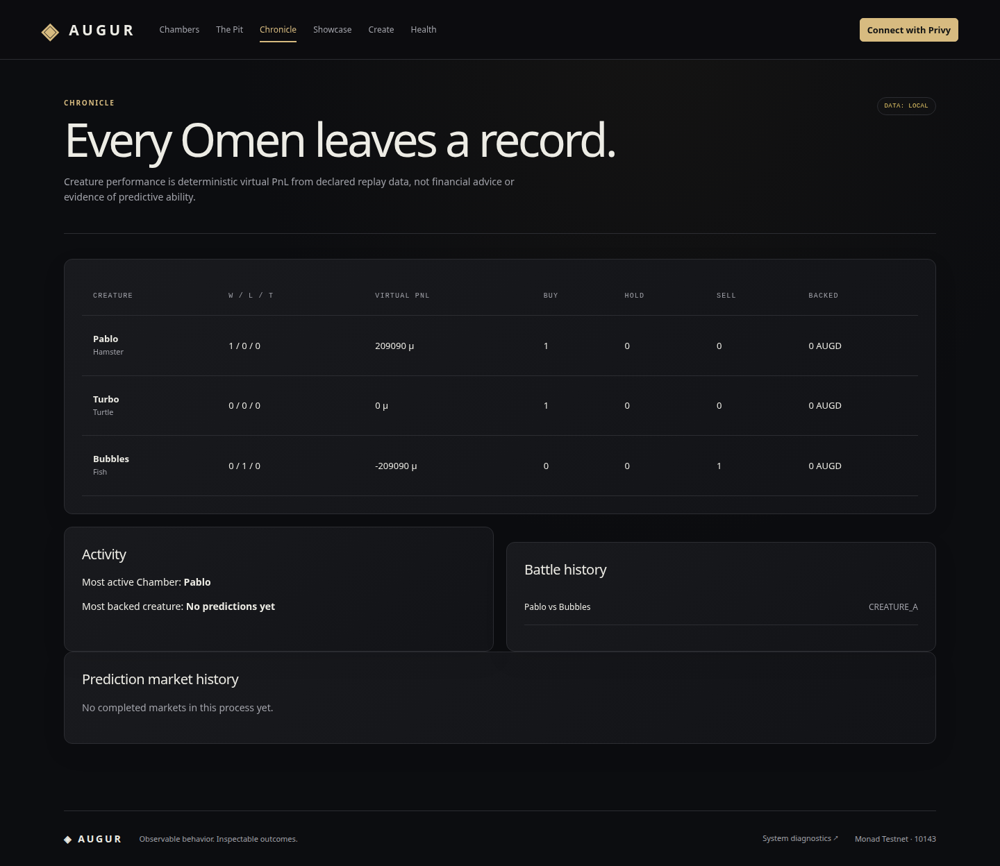

# Augur

### Instinct becomes an Omen.

Augur turns observable creature behavior into deterministic BUY, HOLD, and SELL signals, then uses those **Omens** to resolve short prediction markets on Monad. Enter a Chamber, follow its observations, predict the next Omen, and inspect the evidence behind the result. Every publication binds a creature, a sequence, a ruleset, and a provenance commitment; the animal never trades or holds funds.



**Monad Testnet · chain 10143** · [Deployment records](deployments/monad-testnet-10143-67521320.json) · [CRE verification](cre/README.md) · [Indexer setup](indexer/README.md)

## Watch. Predict. Inspect.

Livestreams usually leave viewers watching from the sidelines. Augur makes an observable event the center of a short market, with a record of how it became an outcome.

```text
Source → Observation → Behavior → Omen → Proof of Omen
                                            ↓
                                  Oracle validation
                                            ↓
                              Publication on Monad
                                            ↓
                              Resolution → Claim
```

The current media experience uses clearly labeled deterministic centroid fixtures. The Monad deployment, indexed smoke lifecycle, RPC reads, and Privy approval transaction have been verified on the real testnet. The screenshots below show the running production web build with **local fixture data**, not a live animal feed or a fabricated testnet session.

## Inside the product

| Surface | What to explore |
| --- | --- |
| `/` | Chamber discovery, source labels, current Omens, and integration scope |
| `/chambers/[slug]` | Observation replay, current Omen, market controls, separate approval/prediction feedback, chat and reactions |
| `/chambers/[slug]/proof` | Source, detection, ruleset, manifest, and publication evidence |
| `/battles` and `/battles/[id]` | Creature matchups with deterministic virtual PnL and declared price fixtures |
| `/chronicle` | Omen counts, standings, backing, and market history |
| `/create` | Constrained species, source references, ruleset templates, and ownership |
| `/showcase` | Repeated concurrent local market rounds and their event stream |
| `/health` | Configured providers, chain checks, indexing, and runtime boundaries |

### The Chamber



The observation display is a centroid visualization. Market mode and source mode remain explicit. Contract approval, prediction, and settlement each retain their own status and transaction hash.

### Repeated rounds



The Showcase runs independent Chamber cycles and records their transitions. Its counters and durations measure **local application operations**, not Monad TPS. The GIF captures the actual Start cycles / Stop cycles flow.

### The record behind the outcome



[Proof view](docs/images/proof.png) · [The Pit](docs/images/battles.png) · [Create Chamber](docs/images/create.png) · [Mobile discovery](docs/images/home-mobile.png) · [Real Privy login dialog](docs/images/wallet-login.png)

## Verified integrations

| Integration | Role | Verified scope |
| --- | --- | --- |
| **Monad** | Contract publication and market settlement | Six deployed contracts; full registry-to-claim smoke lifecycle on testnet 10143 |
| **Envio** | Event-derived Chamber, Omen, market, and history views | Local HyperIndex indexed the real Monad smoke events; GraphQL-to-web adapter passed |
| **Alchemy** | Server-side Monad RPC | Chain, block, bytecode, contract read, receipt, and log queries verified; generic Monad RPC fallback |
| **Privy** | Authentication, wallet availability, network selection, signing | Login/reconnect and a real 1 AUGD DemoToken approval verified |
| **Chainlink CRE** | Provenance-bound request validation and deterministic publication-call preparation | Official v1.36.0 build and authenticated simulation passed, including rejection cases; deployment access remains blocked |

CRE is an optional orchestration path. It checks requests from Augur's deterministic oracle flow; it does not generate animal behavior, establish camera honesty, or broadcast the historical smoke Omen again. There is no deployed CRE workflow ID. See [the exact simulation and deployment boundary](cre/README.md).

### Public testnet proof

- OmenPublisher: `0x333c7ba28b6Eec62f51d111d161fc52fd3ADAa1a`
- NextOmenMarket: `0x334761518FAD86f9cddDbE16a42CFb9316fD4D9E`
- DemoToken: `0xFF35f01886B83D1782e1170c33D3A11E75b0e90e`
- Privy-signed `DemoToken.approve(NextOmenMarket, 1e18)`: `0x0bf842f8992228d54da917523ce075aa930bad76888148ec09b637ff17d5584a`, confirmed in block **67812342**. Receipt, calldata, Approval event, and allowance were independently checked.

The indexed smoke path includes Creature registration, Chamber activation, Omen publication, market opening, prediction, lock, BUY resolution, and claim. All addresses, blocks, and smoke transaction hashes are in [public deployment metadata](deployments/monad-testnet-10143-67521320.json). No hosted web or indexer endpoint is claimed here.

## Architecture

| Module | Responsibility |
| --- | --- |
| `vision/` | Deterministic observation/behavior rules and Proof of Omen manifests |
| `oracle/` | Provenance and policy validation, replay checks, publication journal, EVM/CRE boundaries |
| `cre/` | Real CRE HTTP workflow, request validation and prepared Monad calldata |
| `contracts/` | Registries, OmenPublisher, DemoToken, NextOmenMarket and BattleCoordinator |
| `indexer/` | Envio schema and event projections |
| `web/` | Next.js product, Privy wallet, contract writes, indexed reads, local social persistence |

Protocol truth stays onchain. Envio serves derived views; SQLite stores application and social data. Chat and reactions never determine Omens or settlement. A configured indexer failure remains an error and does not silently substitute fixtures.

## Run locally

Prerequisites: Node.js 22+, pnpm, Python 3.11+, and Foundry for contract tests. CRE uses Bun and the official CRE CLI. Docker and an Envio token are required for local HyperIndex.

```bash
make install

# Explicit local wallet session and labeled fixture data
cd web
NEXT_PUBLIC_PRIVY_LOCAL_MODE=true pnpm dev
```

Open `http://localhost:3000`. This local command does not sign blockchain transactions. It assumes `ENVIO_GRAPHQL_URL` is unset; an existing configured endpoint continues to select indexed reads.

For the verified wallet and testnet setup, use ignored environment files: root `.env` for shell tools and `web/.env.local` for Next.js. Start from the corresponding `.env.example` without overwriting an existing configuration. Next.js does not automatically load the repository-root `.env` from `web/`; export it in your shell when using that file.

| Configuration | Purpose |
| --- | --- |
| `NEXT_PUBLIC_PRIVY_APP_ID` | Public Privy application identifier |
| `NEXT_PUBLIC_MONAD_RPC_URL` | Deliberately public browser RPC |
| `NEXT_PUBLIC_MONAD_CHAIN_ID` | `10143` for Monad Testnet |
| `NEXT_PUBLIC_*_ADDRESS` | Deployed contract addresses from `.env.example` |
| `ALCHEMY_MONAD_RPC_URL` | Preferred server-only RPC |
| `MONAD_RPC_URL` | Generic server RPC fallback |
| `ENVIO_GRAPHQL_URL` | Indexed data source; failures remain explicit |
| `CHAINLINK_CRE_WORKFLOW_ID` | Only set after a real CRE deployment exists |

Keep server RPC credentials and signing keys out of `NEXT_PUBLIC_*`. Remove explicit local wallet mode to use Privy. A missing Privy configuration produces an unavailable state rather than fake authentication.

```bash
# Production web build; load your intended environment first
cd web
pnpm build
pnpm start
```

## Verify

```bash
make test-vision
make test-oracle
make test-contracts
make test-web
make test-indexer

cd web
pnpm typecheck
pnpm lint
pnpm build

cd ../cre/augur-omen-workflow
bun test
bun run typecheck
```

[CRE instructions](cre/README.md) include the official authenticated simulator invocation. [Deployment instructions](deployments/README.md) cover contract verification and the split smoke lifecycle. [Envio instructions](indexer/README.md) cover local indexing.

## Presentation assets

All images in [`docs/images/`](docs/images/) are captures of the actual production app. The Showcase GIF contains successive browser frames. Species emblems are original SVG illustrations, labeled as illustrations in the interface. The wallet capture shows the real login dialog with no authenticated user or personal information; it does not claim a new login or transaction during the visual pass.

The visual system uses shared CSS tokens, lightweight SVGs, and CSS transitions without an animation dependency. New Omen sequences trigger a reveal, centroid changes interpolate, new stream entries enter subtly, and pending transaction feedback pulses until its state changes. Reduced-motion preferences disable animations and transitions.

## Current boundaries

See the [final submission audit](docs/SUBMISSION-AUDIT.md) for the live-data checks
and remaining indexed amount, mobile layout, and media-control presentation issues.

- Camera extraction and live animal streaming are not implemented; controlled trajectory fixtures are labeled.
- Only Next Omen markets are implemented. Battle scores are virtual PnL, not animal-managed funds or a battle betting market.
- DemoToken is strictly a test asset. Contracts have not received an external security audit.
- Envio has been verified locally against Monad; a hosted endpoint is still needed for a public demo.
- CRE simulation is verified. Organization deployment access is not enabled.
- Created Chambers and social data persist in SQLite; seeded market and Showcase state are process-local.
- Permissionless testnet creation requires reviewed, allowlisted rules and an enabled registry policy. Uploaded clips and webcam sources remain constrained adapter boundaries.
- Hash verification demonstrates artifact consistency, not source honesty.
